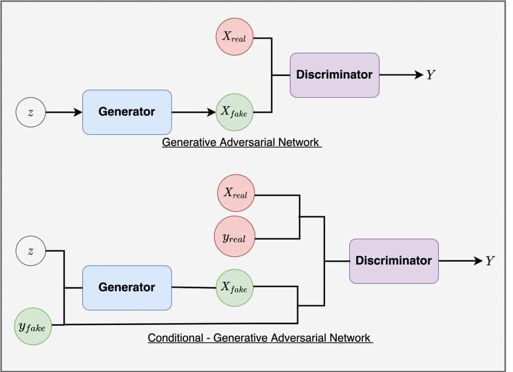
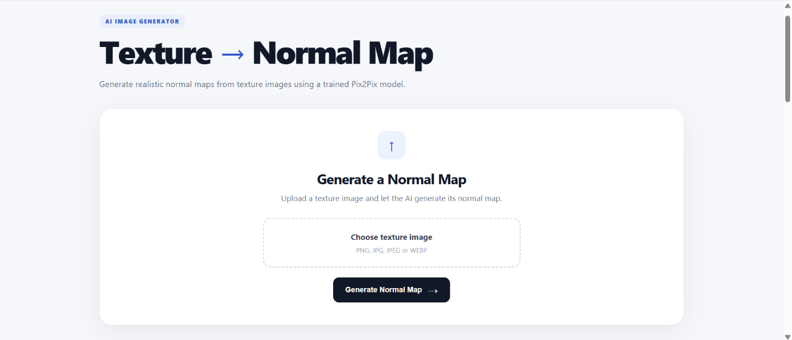
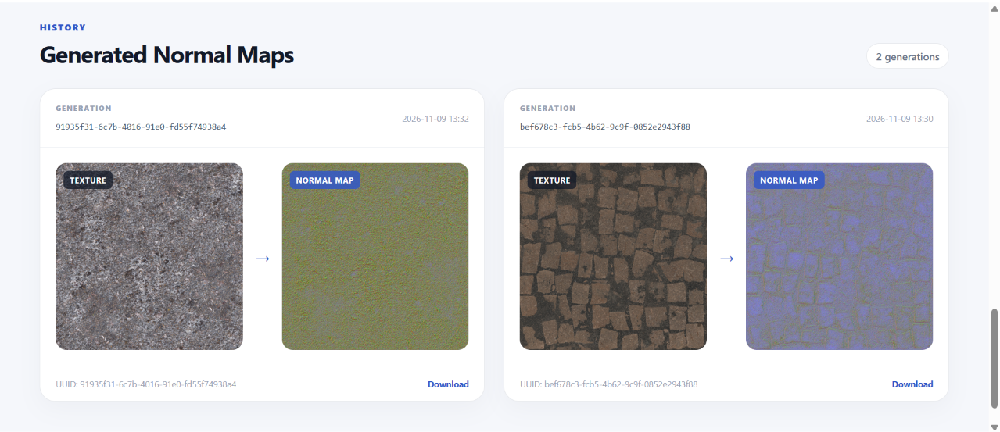

# Deep Learning-Based Texture to Normal Map Synthesis via Conditional Generative Adversarial Networks

## Abstract

In contemporary computer graphics, physically based rendering (PBR), and real-time visualization pipelines, normal mapping represents a fundamental technique for simulating complex micro-surface geometry and high-frequency surface relief without inflating polygonal complexity. However, the conventional generation of accurate normal maps from diffuse or albedo textures typically relies on manual artist intervention, photometric stereo acquisition, or naive gradient-based filtering methods that struggle to infer true depth contours. This project presents an end-to-end deep learning framework designed to synthesize high-fidelity tangent-space normal maps directly from arbitrary two-dimensional texture images. Built upon a Conditional Generative Adversarial Network (cGAN) paradigm, the system leverages a fully convolutional U-Net generator trained to learn the conditional probability distribution of surface normal orientations conditioned on input texture representations. The trained model is integrated into a production-grade web application offering real-time inference, persistent relational tracking, and reproducible deployment via containerization and infrastructure-as-code automation.

## Problem Formulation and Theoretical Foundation

### The Role of Normal Mapping in Graphics Pipelines

Surface shading in modern graphics engines is governed by illumination models that compute reflectance as a function of the angle between light vectors and surface normal vectors. Traditional low-polygon meshes lack the geometric density necessary to represent fine surface roughness, cracks, and bevels. A normal map encodes perturbed surface normal vectors (nx, ny, nz) directly into the color channels of an image:

- Red channel corresponds to the tangential x-component.
- Green channel corresponds to the bitangential y-component.
- Blue channel corresponds to the surface-orthogonal z-component.

Because unit normal vectors satisfy the condition that the sum of their squared components equals one and point outwards toward the viewer in tangent space, vectors spanning from negative one to positive one are mapped to eight-bit unsigned color values between zero and 255. Accurately deducing these spatial orientations from a monocular, flat texture image is inherently ill-posed, as lighting variations, intrinsic albedo patterns, and ambiguous shadow cues must be decoupled from geometric height variations.

### Conditional Generative Adversarial Networks (cGAN)

To resolve this ambiguity, the problem is formulated as image-to-image translation within a supervised adversarial framework. While standard Generative Adversarial Networks (GANs) learn a mapping from random noise vectors to output images, Conditional GANs learn a mapping from an observed image x to an output image y, guided by an adversarial game between a Generator (G) and a Discriminator (D).

The objective function of a conditional GAN combines an adversarial loss with an L1 reconstruction loss to enforce both structural plausibility and pixel-wise fidelity:

The adversarial loss encourages the generator to produce outputs that are indistinguishable from real normal maps according to the discriminator:

L_cGAN(G, D) = E[log D(x, y)] + E[log(1 - D(x, G(x)))]

To capture low-frequency alignment and minimize spatial hallucination, an L1 distance term is introduced:

L_L1(G) = E[ || y - G(x) ||_1 ]

The complete objective optimized during model training is expressed as:

G* = arg min_G max_D ( L_cGAN(G, D) + lambda * L_L1(G) )

where lambda is a weighting hyperparameter balancing photorealistic high-frequency sharpness against exact structural alignment.

## Model Architecture

The generative model employs an eight-stage symmetric U-Net architecture characterized by an encoder-decoder topology enhanced with skip connections between mirrored contracting and expanding resolutions.

### Encoder (Contracting Path)

The contracting path sequentially reduces spatial dimensions from an input resolution of 512 by 512 pixels down to a 2 by 2 bottleneck representation while hierarchically extracting multi-scale semantic and geometric features:

1. Layer d1: 2D Convolution mapping 3 input color channels to 64 feature maps, utilizing a 4x4 kernel, stride 2, and padding 1, followed by LeakyReLU activation (slope 0.2). Batch normalization is omitted in this entry layer.
2. Layer d2: 2D Convolution expanding from 64 to 128 channels, Batch Normalization, LeakyReLU.
3. Layer d3: 2D Convolution expanding from 128 to 256 channels, Batch Normalization, LeakyReLU.
4. Layer d4: 2D Convolution expanding from 256 to 512 channels, Batch Normalization, LeakyReLU.
5. Layer d5: 2D Convolution operating from 512 to 512 channels, Batch Normalization, LeakyReLU.
6. Layer d6: 2D Convolution operating from 512 to 512 channels, Batch Normalization, LeakyReLU.
7. Layer d7: 2D Convolution operating from 512 to 512 channels without batch normalization, LeakyReLU.
8. Layer d8 (Bottleneck): 2D Convolution operating from 512 to 512 channels without batch normalization, LeakyReLU.

### Decoder (Expanding Path) and Skip Connections

To preserve fine spatial textures and localized edge gradients that are typically lost during progressive downsampling operations, skip connections concatenate the output of each encoder layer directly to the corresponding decoder stage along the channel axis:

1. Layer u1: 2D Transposed Convolution upsampling 512 bottleneck channels to 512 channels, Batch Normalization, ReLU, with 20% Dropout for stochastic regularization.
2. Layer u2: Concatenation of u1 and encoder layer d7 (yielding 1024 channels), Transposed Convolution down to 512 channels, Batch Normalization, ReLU, Dropout (0.2).
3. Layer u3: Concatenation of u2 and d6 (1024 channels), Transposed Convolution down to 512 channels, Batch Normalization, ReLU, Dropout (0.2).
4. Layer u4: Concatenation of u3 and d5 (1024 channels), Transposed Convolution down to 512 channels, Batch Normalization, ReLU.
5. Layer u5: Concatenation of u4 and d4 (1024 channels), Transposed Convolution down to 256 channels, Batch Normalization, ReLU.
6. Layer u6: Concatenation of u5 and d3 (512 channels), Transposed Convolution down to 128 channels, Batch Normalization, ReLU.
7. Layer u7: Concatenation of u6 and d2 (256 channels), Transposed Convolution down to 64 channels, Batch Normalization, ReLU.
8. Final Layer: Concatenation of u7 and d1 (128 channels), Transposed Convolution mapping to 3 channels, followed by a Hyperbolic Tangent (Tanh) activation function to bound predicted tensor values within the normalized interval [-1, 1].

## Data Processing Pipeline

Inference execution adheres to strict geometric normalization standards to match training distributions:

1. Ingestion: Input files in PNG, JPG, JPEG, or WEBP formats are loaded and validated.
2. Color Space Standardization: Images are converted to the standard RGB color space, discarding non-uniform alpha channels.
3. Spatial Rescaling: Images are bilinearly interpolated to a fixed spatial dimension of 512 by 512 pixels.
4. Tensor Normalization: Pixel intensities spanning [0, 255] are transformed into floating-point tensors and normalized using mean (0.5, 0.5, 0.5) and standard deviation (0.5, 0.5, 0.5), mapping values to [-1.0, 1.0].
5. Inference: The normalized tensor is passed through the evaluation-mode generator inside a no-gradient context execution block on the active compute device (CUDA GPU or CPU fallback).
6. Post-Processing and Denormalization: The resulting continuous normal tensor is mapped back into displayable color space via the affine transformation: (tensor * 0.5) + 0.5, clamped to [0.0, 1.0], permuted from Channel-Height-Width to Height-Width-Channel layout, and converted into an 8-bit unsigned integer RGB image representation.

## System Architecture and Implementation

The project is structured as an integrated, multi-tier software system encompassing model inference, web delivery, database persistence, and automated cloud infrastructure.

### Technology Stack Summary

- Machine Learning Framework: PyTorch and Torchvision
- Image Processing: Python Imaging Library (Pillow)
- Web Application Framework: Flask
- Object Relational Mapping (ORM): Flask-SQLAlchemy
- Relational Database: SQLite
- Web Server Gateway: Apache2 with mod_wsgi daemon mode
- Containerization: Docker (Debian Bookworm base image)
- Infrastructure as Code: Terraform (DigitalOcean cloud provider)
- Configuration and Provisioning: Ansible automation playbooks
- Code Quality and Formatting: Ruff linter and formatter

### Application Workflow and User Interface

The web interface enables users to submit raw surface textures, trigger instant neural inference, visualize the synthesized normal maps, and inspect historical transformations.

Figure 2 displays the primary interface where users upload texture files. The application validates the image format, passes the input to the PyTorch inference pipeline, and immediately renders the synthesized normal map with an integrated direct download option.

Figure 3 showcases the generation archive. Each execution generates a unique UUID identifier and stores metadata in the relational database, presenting a side-by-side visual comparison between original diffuse textures and their corresponding synthesized normal maps along with timestamps and asset retrieval endpoints.

### Relational Schema

The underlying database schema records all generated artifacts through the NormalMap entity:

- id: String (36 characters), Universally Unique Identifier (UUID v4) serving as primary key.
- texture_url: String (500 characters), relative uniform resource indicator pointing to the persisted input texture file.
- normal_map_url: String (500 characters), relative uniform resource indicator pointing to the generated normal map artifact.
- created_at: DateTime, UTC timestamp indicating creation time for chronological ordering.

## Operational Deployment and Containerization

The production configuration isolates the application environment within a reproducible Docker container:

1. Base Environment: Minimal Debian Bookworm operating system containing Python 3 and Apache2 runtime packages.
2. Web Server Configuration: Apache2 configured with mod_wsgi in daemon mode, routing incoming port 80 traffic to the WSGI application entry point while directly serving static asset directories for optimal performance.
3. Process Management: Isolation of execution permissions under the standard www-data system account with explicit directory privilege controls.
4. Infrastructure Automation: Declarative Terraform configurations automate the provisioning of cloud instances, SSH key associations, and network firewall policies, while Ansible handles system configuration.

## Conclusion and Future Perspectives

This system demonstrates the efficacy of Conditional Generative Adversarial Networks for geometric normal map estimation directly from monocular visual textures. By coupling a U-Net architecture with skip connections, the framework accurately reconstructs continuous surface angles and high-frequency tactile contours necessary for modern real-time rendering. Prospective improvements include integrating physical roughness and metallic map estimation (complete PBR material synthesis), supporting arbitrary multi-resolution tiling via patch-based processing, and integrating normal map validation metrics such as angular deviation error and surface curvature consistency.
